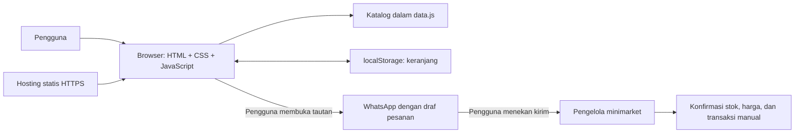
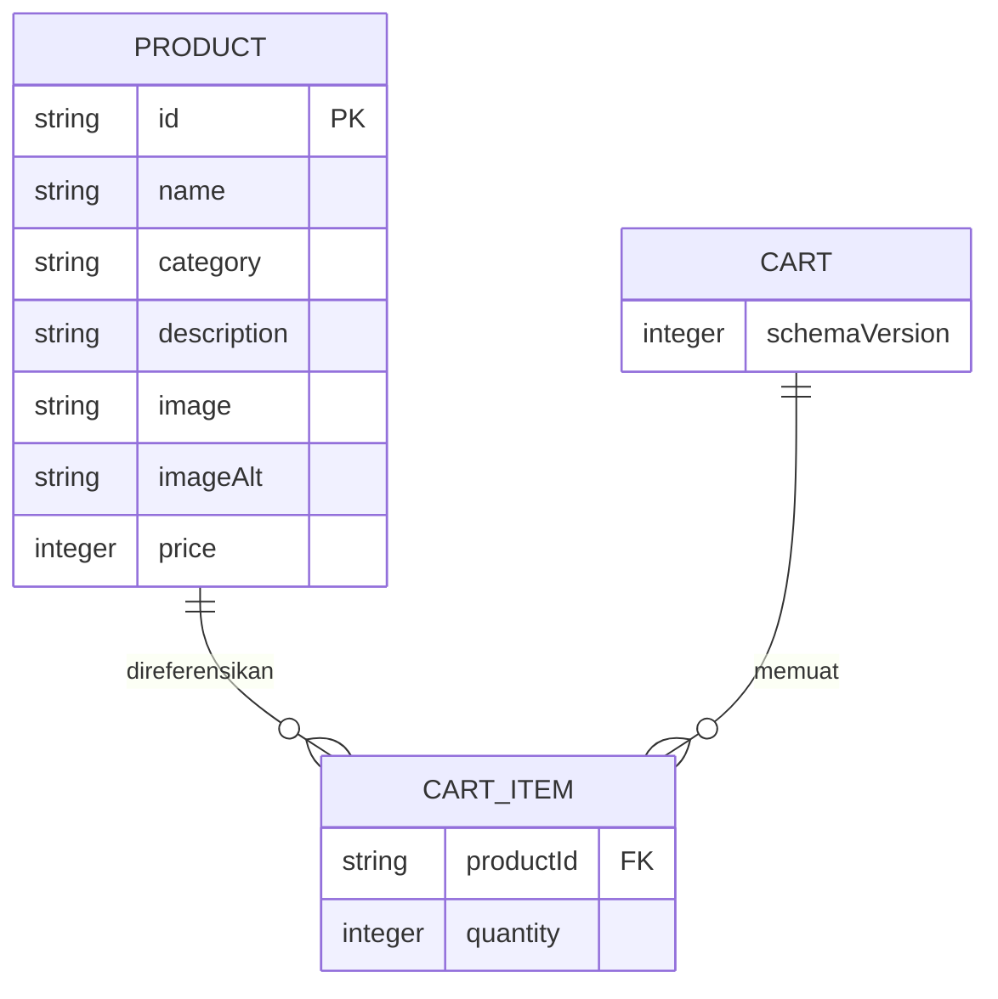

# Arsitektur Sistem — Minimarket Kita

## 1. Bentuk sistem
Aplikasi frontend statis satu halaman yang dibagi menjadi modul JavaScript. Hosting mengirim HTML, CSS, JavaScript, dan gambar. Pencarian, manipulasi keranjang, dan perhitungan total berjalan di browser; tidak ada backend pada MVP.



## 2. Struktur berkas aplikasi
```text
minimarket/
├── index.html
├── css/
│   └── styles.css
├── js/
│   ├── config.js       # Identitas usaha dan nomor WhatsApp publik
│   ├── data.js         # Data katalog
│   ├── app.js          # Inisialisasi, render, pencarian, filter
│   ├── cart.js         # Manipulasi keranjang dan perhitungan
│   ├── storage.js      # Baca/tulis aman, validasi skema
│   └── checkout.js     # Validasi formulir dan pembentukan tautan
└── assets/images/
```

Repository pengembangan dapat menyertakan `README.md`, dokumen kebutuhan, pengujian, dan skrip paket. Dokumentasi internal tidak perlu dimasukkan ke paket publik.

## 3. Model data

Diagram ini menggambarkan objek frontend, bukan tabel database yang sudah tersedia. Nama dan nomor kontak hanya digunakan sementara pada formulir. Subtotal dan total adalah nilai turunan yang dihitung ulang.

Contoh penyimpanan dengan kunci `minimarket-kita:cart:v1`:
```json
{
  "schemaVersion": 1,
  "items": [
    { "productId": "air-mineral-600ml", "quantity": 2 }
  ]
}
```

## 4. Alur kerja
### Memuat halaman
1. Muat konfigurasi dan katalog lokal.
2. Baca `localStorage` dalam `try/catch`.
3. Validasi versi, tipe data, ID produk yang dikenal, dan jumlah bulat 1–99.
4. Abaikan entri rusak atau ID yang tidak ada; reset data dengan versi skema yang tidak dikenal.
5. Render katalog, keranjang, subtotal, dan total menggunakan harga katalog terkini.

### Mengubah keranjang
1. Terima ID produk dari kontrol UI dan cocokkan dengan katalog.
2. Tambah, ubah jumlah, atau hapus item dari satu sumber state.
3. Hitung ulang subtotal setiap produk (`harga × jumlah`) dan total.
4. Render ulang lalu simpan hanya bagian state yang diperbolehkan.
5. Jika penyimpanan gagal, pertahankan state sesi dan tampilkan pemberitahuan singkat.

### Mengirim pesanan
1. Validasi keranjang, nama bila diwajibkan, dan nomor kontak sesuai aturan formulir.
2. Tampilkan ringkasan final dengan keterangan bahwa harga/stok perlu dikonfirmasi.
3. Susun teks dari katalog dan state terbaru; encode seluruh teks memakai `encodeURIComponent`.
4. Bentuk `https://wa.me/<nomor-usaha>?text=<pesan>` dari nomor internasional yang hanya berisi digit.
5. Buka tautan melalui tindakan pengguna. Jangan mengirim pesan otomatis atau menampilkan status “pesanan berhasil”.
6. Pertahankan keranjang setelah pengalihan; membuka WhatsApp belum berarti transaksi selesai.

## 5. Perhitungan jumlah dan biaya
Harga produk disimpan sebagai integer rupiah. Subtotal dihitung dengan `price * quantity`, dengan jumlah berupa integer 1–99. Total adalah penjumlahan subtotal semua item. Format angka memakai `Intl.NumberFormat('id-ID', { style: 'currency', currency: 'IDR', maximumFractionDigits: 0 })`. Hitung ulang dari katalog saat halaman dibuka; jangan mempercayai harga yang disimpan browser.

## 6. Integrasi dan batas kepercayaan
WhatsApp merupakan satu-satunya integrasi pihak ketiga MVP melalui tautan biasa tanpa SDK/API. Data kontak dan rincian pesanan akan masuk ke URL WhatsApp saat pengguna menekan tombol; beri penjelasan di dekat tombol. Jangan meminta data sensitif seperti nomor identitas. Browser dan `localStorage` dapat dimodifikasi, sehingga total merupakan perkiraan dan harus diperiksa pengelola.

## 7. Keamanan dan penanganan kegagalan
Gunakan `textContent` atau DOM API untuk input pengguna dan data dinamis; hindari memasukkan input pengguna ke `innerHTML`. Jika memakai tab baru, gunakan `rel="noopener noreferrer"`. Jangan mempercayai stok dari browser. Gambar gagal dimuat memiliki fallback lokal. Pencarian kosong, jumlah tidak valid, storage tidak tersedia, dan nomor WhatsApp usaha yang tidak valid harus memiliki keadaan UI yang jelas. Sertakan pesan `noscript` untuk fitur interaktif.

## 8. Deployment
Unggah aset runtime ke hosting statis melalui HTTPS. Tidak ada proses build, migrasi database, atau fungsi server. Untuk rollback, unggah ulang paket runtime versi sebelumnya.
